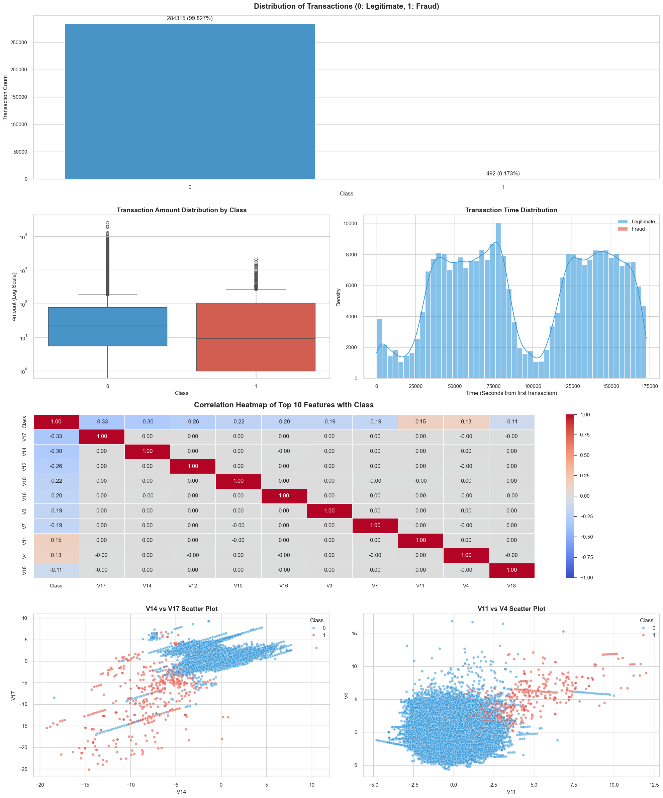
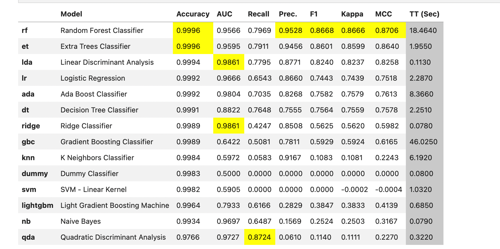
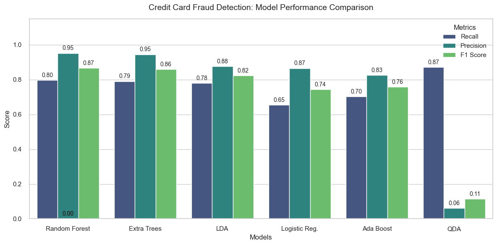
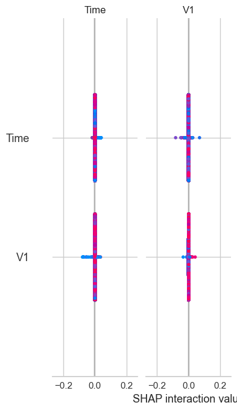

# 🛡️ Real-Time Credit Card Fraud Detection & Explainable AI

An end-to-end Machine Learning pipeline engineered to detect fraudulent credit card transactions within highly imbalanced financial datasets. This project covers the entire ML lifecycle: automated exploratory data analysis, robust model selection using PyCaret, model interpretability via SHAP, and a real-time Streamlit dashboard for business operations.

## 📊 1. Exploratory Data Analysis (EDA)
Understanding the distribution of PCA-transformed features (V1-V28) and handling extreme class imbalance (fraud accounts for <0.2% of transactions) was the first critical step. 

* **Automated Profiling:** A comprehensive HTML report was generated using Sweetviz. Download or view `reports/sweetviz_report.html` for deep-dive feature distributions.
* **Feature Relationships:** General feature behaviors, class separations, and correlations are visualized below.

*Figure 1: Class distribution, correlation heatmaps, and outlier analysis of highly correlated components.*

## ⚙️ 2. Model Selection & Performance Evaluation
To address the severe class imbalance, multiple algorithms were trained and evaluated focusing on **Precision, Recall, and F1-Score** rather than raw accuracy. The models were prototyped and benchmarked using PyCaret.

*Figure 2: PyCaret baseline classification results across different algorithms.*

After benchmarking, Tree-based algorithms (specifically Random Forest and Extra Trees) demonstrated the most balanced trade-off between minimizing false positives (Precision) while successfully capturing fraud (Recall).

*Figure 3: Detailed metric comparison (Recall, Precision, F1-Score) of the top-performing models.*

## 🧠 3. Explainable AI (XAI)
In the financial sector, black-box models are a regulatory and operational risk. SHAP (SHapley Additive exPlanations) values were extracted to provide transparency into how the model evaluates each transaction.

*Figure 4: SHAP interaction and dependence plots, illustrating how components like V14 and V17 predominantly drive the model's fraud predictions.*

## 🚀 4. Real-Time Fraud Detection Application
The optimal model was serialized (`.pkl`) and deployed into a real-time interactive web application using Streamlit. This dashboard allows financial analysts to input transaction details, receive instant fraud risk probabilities, and read auto-generated, human-readable explanations for the AI's decision.

### Running the Application Locally
1. Clone the repository:
   git clone [https://github.com/yourusername/RealTime-Fraud-Detection.git](https://github.com/AInancKaya/RealTime-Fraud-Detection.git)
   cd RealTime-Fraud-Detection
2. Install the required dependencies:
   pip install -r requiremnts.txt
3. Launch the Streamlit dashboard:
   streamlit run app.py
🛠️ Tech Stack
Language: Python
Data Processing & EDA: Pandas, NumPy, Sweetviz, Matplotlib, Seaborn
Machine Learning: Scikit-Learn, PyCaret
Model Interpretability: SHAP
Deployment: Streamlit